# Homelab Client

**A polished Android client for your homelab.** Browse your media library,
drive your downloads, see who is streaming and keep an eye on the server, all
from one app on your phone.

No cloud account, no telemetry, no middleman: the app talks straight to the
services you already run.

[](../../releases/latest)
[](#install)
[](LICENSE)

<p align="center">
  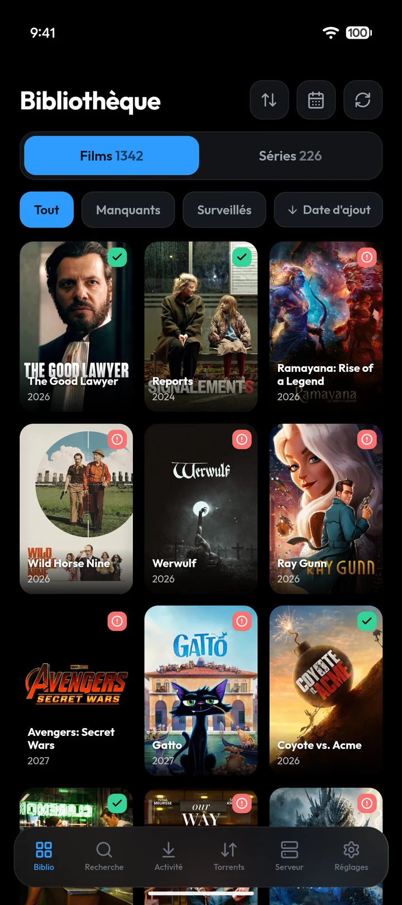
  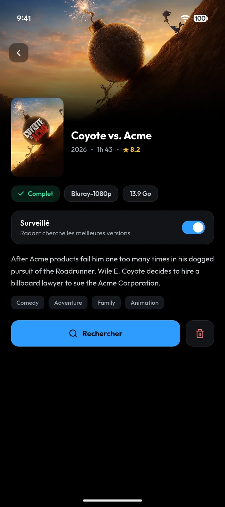
  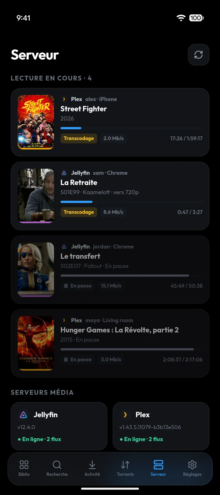
</p>

📦 [**Download the latest APK**](../../releases/latest)

> The interface is in **French** for now.

---

## Supported services

| Service | What you get |
| --- | --- |
| **Radarr** · **Sonarr** | Library, title details, search & add, interactive release search, queue, history, calendar |
| **qBittorrent** | Torrent list and control, directly or through [qui](https://getqui.com)'s Client Proxy |
| **Jellyfin** · **Plex** | Live sessions: who is watching what, on which device, transcoding or not |
| **Glances** | CPU, memory, load, disks and network of the box |
| **Proxmox VE** | Node usage, VMs and containers, storage (read-only) |

Every service is optional: configure the ones you run, the rest stay hidden.

---

## Features

### 📚 Your library, at a glance

A poster grid of everything Radarr and Sonarr know about. Switch between movies
and series, filter down to what's **missing** or **monitored**, and sort by
title, date added, year or size. Built to stay smooth with thousands of titles.
The **Search** tab finds new movies and series and adds them to Radarr or Sonarr.

<p align="center">
  
  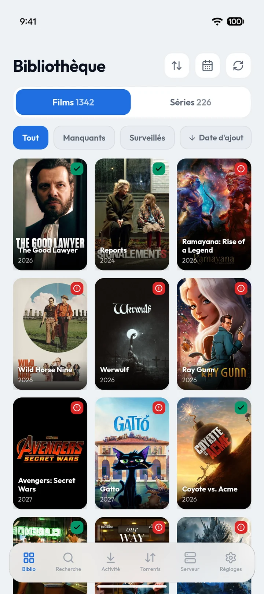
</p>

### 🎬 Every title, in detail

Artwork, synopsis, genres, quality and size. Toggle **monitoring**, start a
**search**, or delete the title, with or without its files.

<p align="center">
  
  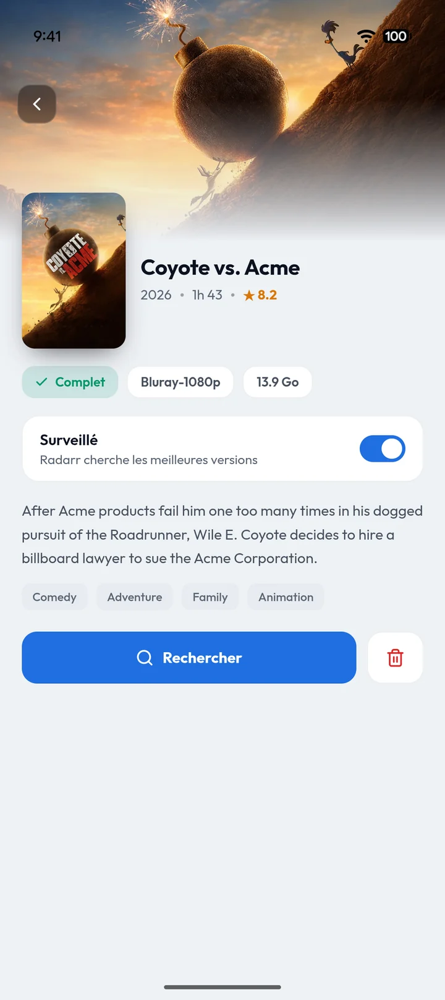
</p>

### 🔎 Pick your own release

Run an **interactive search**: the app queries your indexers and lists every
release with its quality, size, seeders and age, plus the reasons Radarr or
Sonarr would reject it. Tap one to grab exactly that release.

<p align="center">
  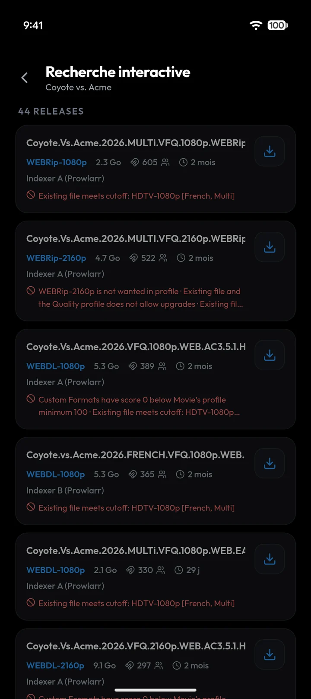
  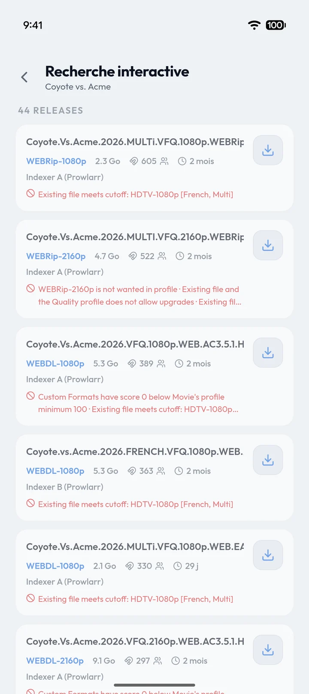
</p>

### ⏳ Activity

The download queue live (progress, speed, ETA), blocked imports you can
resolve from the phone, and what landed recently.

<p align="center">
  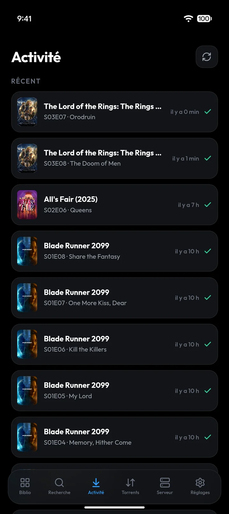
  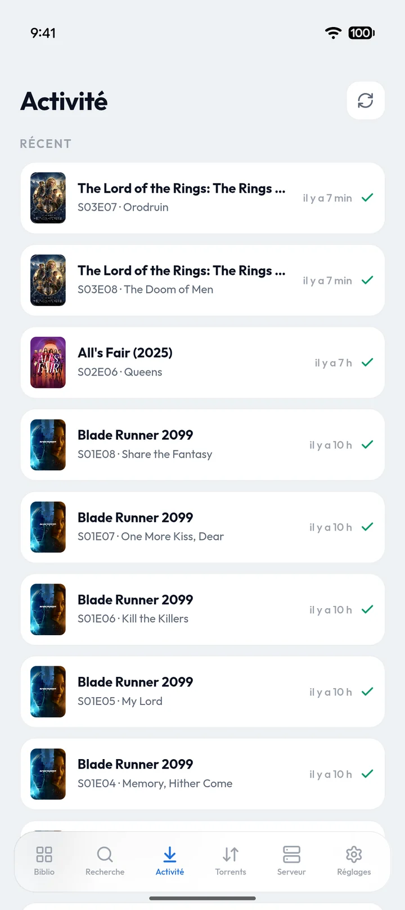
</p>

### 📅 Calendar

Upcoming episodes and releases, as an agenda list or a month view.

<p align="center">
  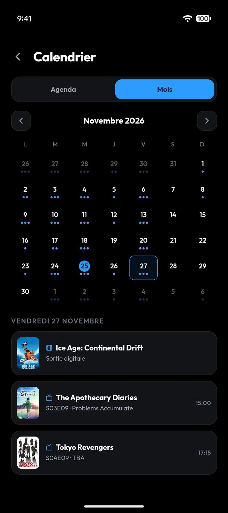
  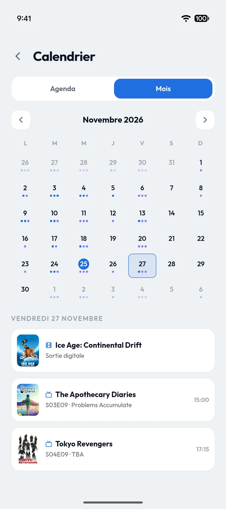
</p>

### 🧲 Torrents

Full qBittorrent control. List and filter your torrents, add magnets, pause,
resume, force-resume, change category or delete. Transfer speeds update live.
Connect through **qui's Client Proxy** (no qBittorrent credentials on the
phone) or **directly** to qBittorrent.

<p align="center">
  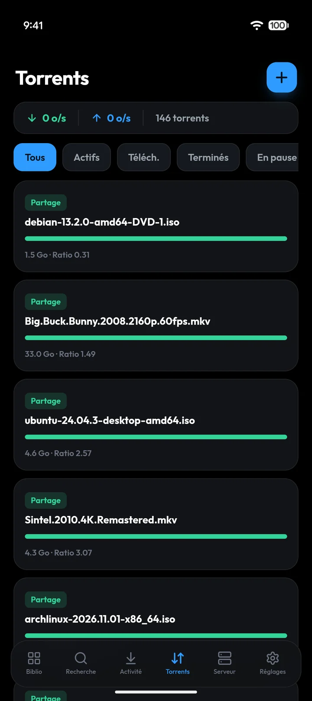
  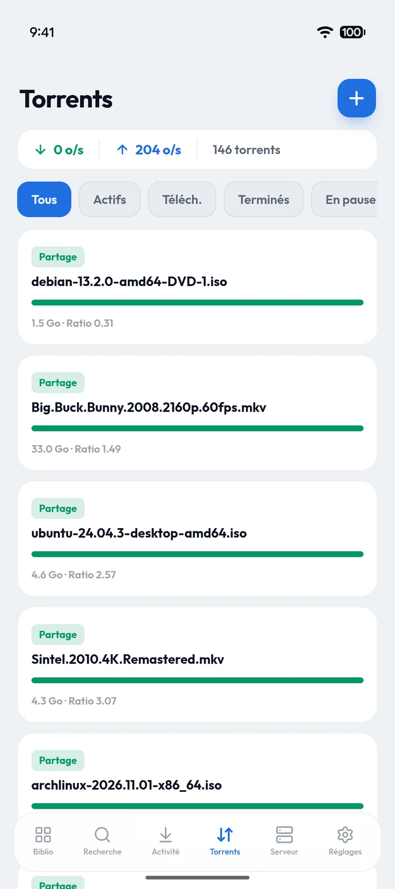
</p>

### 📺 Who is watching

Every active session across **Jellyfin** and **Plex** at once: user, device,
title, progress, bitrate, and whether the server is transcoding.

<p align="center">
  
  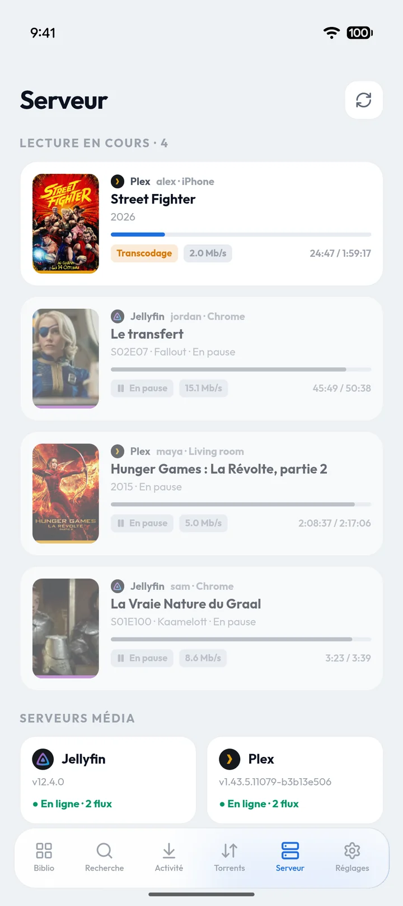
</p>

### 📊 The server itself

Right under the streams that explain the load: a **Glances** view of the
machine (CPU, memory, load, disks, network) and a **Proxmox** view of the node,
its VMs and containers, and its storage.

<p align="center">
  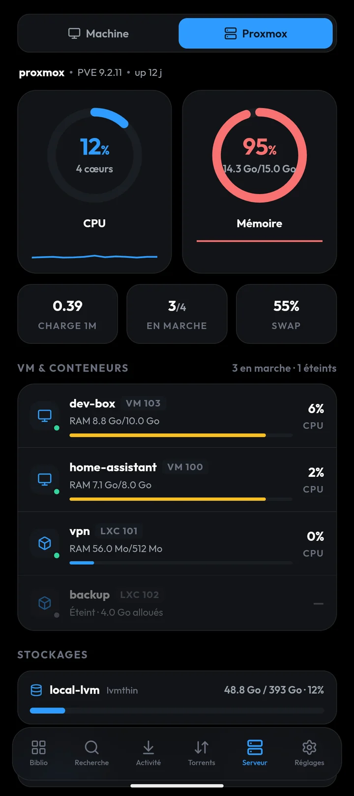
  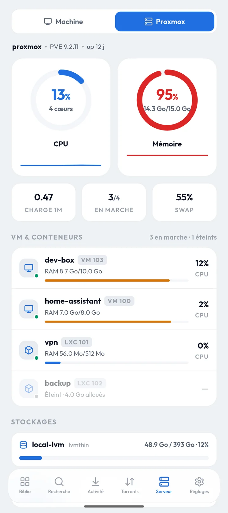
</p>

### 🔄 Updates built in

The app checks this repository's releases and offers new versions itself:
download, verify and hand over to the Android installer, with the release
notes shown in the app.

---

## Install

1. Download `homelab-vX.Y.Z.apk` from the [latest release](../../releases/latest).
2. Open it on your phone and allow installing apps from that source when
   Android asks.
3. Launch **Homelab** and add the address of each service you run.

Requires **Android 7.0** or later. Later updates are offered inside the app.

---

## Connecting your services

Give the app **one full address per service**, the same one you would type in
a browser. `https://` is the default; plain `http://` is accepted for
addresses on your LAN.

| Service | How the app signs in |
| --- | --- |
| Radarr / Sonarr | API key (Settings → General in Radarr/Sonarr) |
| qBittorrent | a **qui Client Proxy URL**, which embeds its own key, or a direct address with an optional login |
| Jellyfin | **Quick Connect**: the app shows a code, you approve it from a session already signed in |
| Plex | a short code entered at **plex.tv/link**, then you pick your server |
| Glances | none |
| Proxmox VE | a username and password, ideally a read-only user with the `PVEAuditor` role; the node's self-signed certificate is pinned when you first accept it |

### Behind a login portal?

If your services sit behind a forward-auth portal (Authelia, Authentik,
tinyauth…), the app cannot get through it: point it at addresses that skip the
portal, such as LAN addresses (`http://192.168.1.10:7878`), reached at home or
**over your VPN** (WireGuard, Tailscale…). With tinyauth, the app recognises
the portal's answer and tells you to connect your VPN instead of failing with
a vague error.

This is also the safer layout: the portal keeps protecting the public domains,
and the phone only ever holds each service's own credentials, never a master
login to the whole homelab.

### Your data stays on the phone

- API keys, passwords and tokens are stored with Android's app-private
  storage (`@capacitor/preferences`), never in the app's regular state.
- Posters come from your own Radarr/Sonarr, not from a third-party image CDN.
- The only outside services contacted are **plex.tv** (if you use Plex) and
  **GitHub** (to check for app updates).

---

## Design

The interface follows its own design language, **"Direction OLED"**: true-black
surfaces, a single blue accent, the Outfit typeface and a floating navigation
bar. Light, dark and auto themes all ship. Every screen starts as a static HTML
mockup ([`design-mockups/`](design-mockups/)) and is built only once the mockup
is approved.

## Built to feel fast

Performance is measured on a real device, not guessed:

- **Instant launch.** The library renders from cache, then refreshes in the
  background. A cold start shows a full grid, no spinner.
- **Covers at the right size.** Artwork is requested from Radarr/Sonarr at
  display resolution instead of full-size originals: about 28× less data per
  poster.
- **Smooth scrolling.** Off-screen cards skip layout and paint, keeping frame
  times low on lists of thousands of items.

---

## Build from source

```bash
./docker/build-apk.sh   # reproducible build: JDK 21, Node 22 and the Android SDK in a container
```

or, with JDK 21 and the Android SDK installed:

```bash
npm install
npm run android:build
```

The APK lands in `android/app/build/outputs/apk/debug/`. Development setup,
signing, CI and releases are covered in
[`docs/development.md`](docs/development.md).

**Stack:** Vue 3 · TypeScript · Vite · Capacitor 8 (Android) · Pinia ·
Reka UI · Tailwind CSS 4 · Lucide icons.

---

## License

[MIT](LICENSE).

Homelab Client is an independent project, not affiliated with Radarr, Sonarr,
qBittorrent, qui, Jellyfin, Plex, Glances or Proxmox. Their names belong to
their respective owners.
